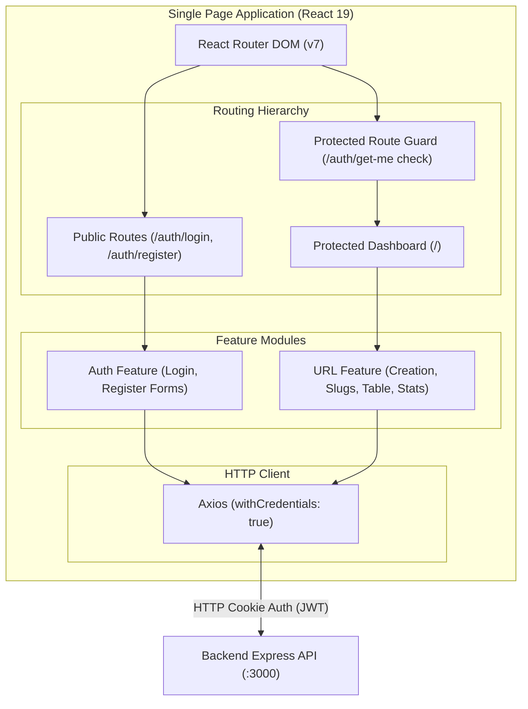

# Frontend — URL Shortener Dashboard

[](https://react.dev/)
[](https://vitejs.dev/)
[](https://reactrouter.com/)
[](https://axios-http.com/)

A modern, responsive Single Page Application (SPA) dashboard for shortening URLs, managing custom links, and monitoring real-time click statistics.

---

## Architecture Overview



---

## Technologies Used

| Category | Technology | Version | Purpose |
|---|---|---|---|
| Framework | React | 19.2.8 | Declarative component UI library |
| Build Tool | Vite | 8.3.0 | Fast HMR dev server and optimized production bundler |
| Router | React Router DOM | 7.18.3 | Client-side declarative routing and protected auth guards |
| HTTP Client | Axios | 1.20.0 | Promise-based HTTP client configured with cookie credentials |
| Linter | ESLint | 10.10.0 | Code quality, hook verification, and syntax enforcement |

---

## Key Design Decisions

1. **Feature-Based Modular Structure**: Code is partitioned under `src/features/` by domain (`auth`, `url`), keeping UI components, state management, and API calls cohesive.
2. **Protected Route Wrapper**: Unauthenticated visits to protected routes automatically redirect to `/auth/login` after verifying the user session.
3. **Cookie-Based Credential Forwarding**: Axios sends `withCredentials: true` by default, allowing the browser to manage `httpOnly` JWT access tokens securely without storing tokens in `localStorage`.
4. **Instant Client-Side Feedback**: URL creation and deletion immediately refresh the local state and link counts for a snappy user experience.

---

## Setup & Run Instructions

### Prerequisites
- Node.js v18+
- Backend API running on `http://localhost:3000`

### 1. Install Dependencies
```bash
cd frontend
npm install
```

### 2. Configure Environment Variables
Create `.env.development`:

```ini
VITE_BASE_URL=http://localhost:5173
VITE_API_BASE_URL=http://localhost:3000
```

### 3. Start Development Server
```bash
npm run dev
```
The application will launch on `http://localhost:5173`.

---

## Available Scripts

| Script | Command | Description |
|---|---|---|
| `npm run dev` | `vite` | Starts local development server with HMR |
| `npm run build` | `vite build` | Compiles production assets into `dist/` |
| `npm run preview` | `vite preview` | Previews production build locally |
| `npm run lint` | `eslint .` | Runs static analysis checks across the codebase |
